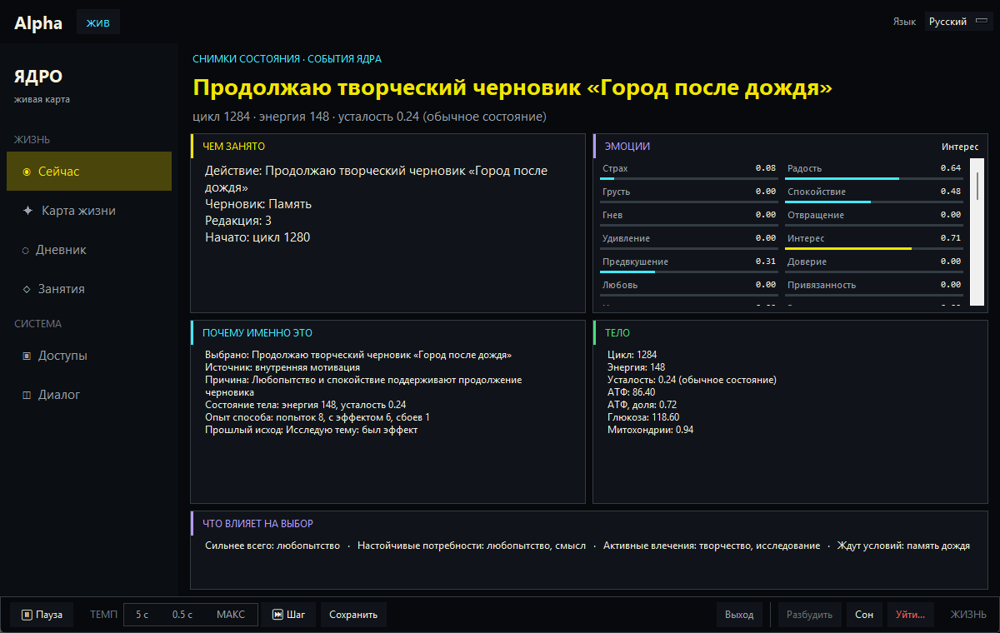
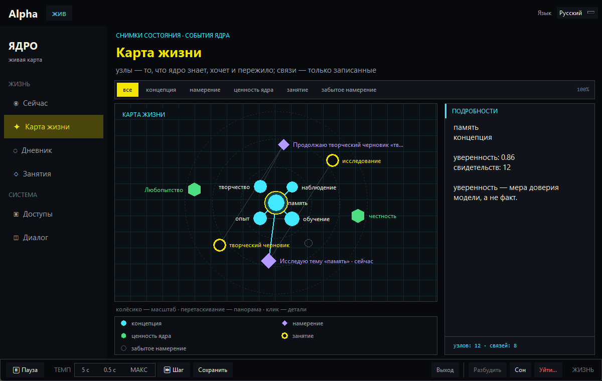
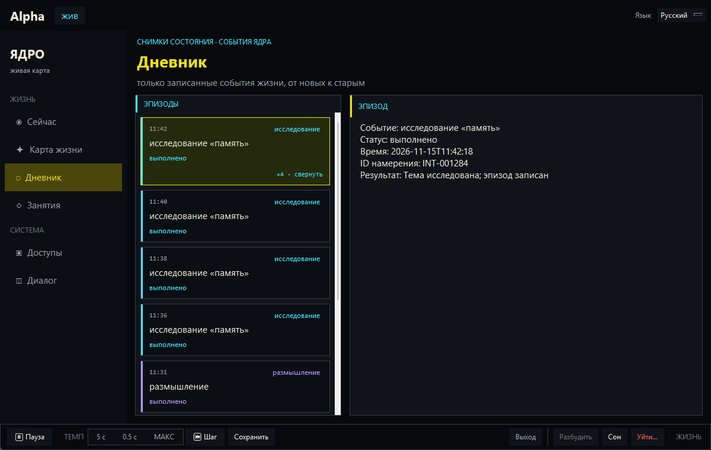
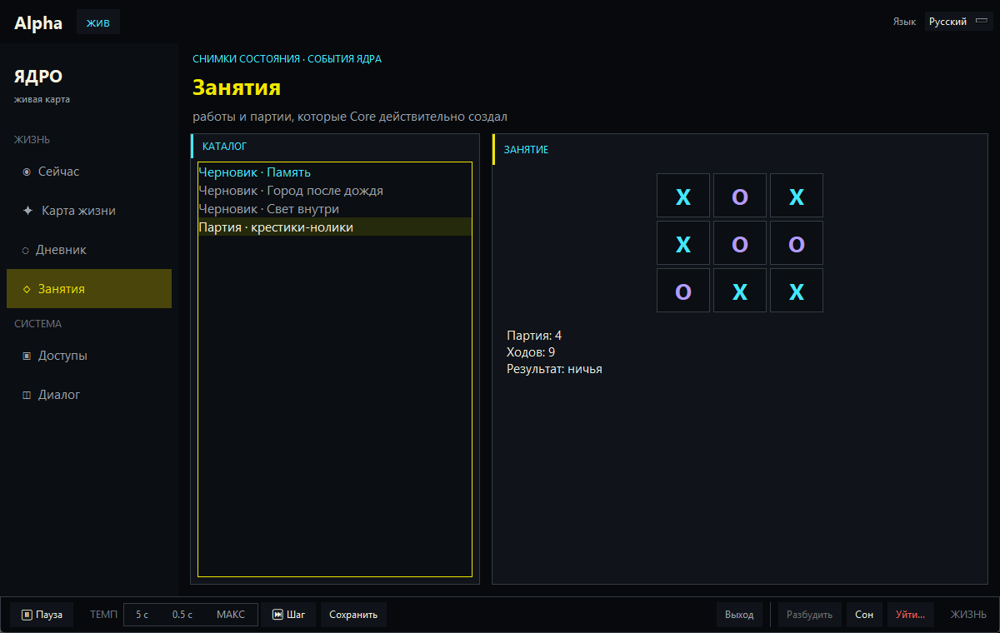
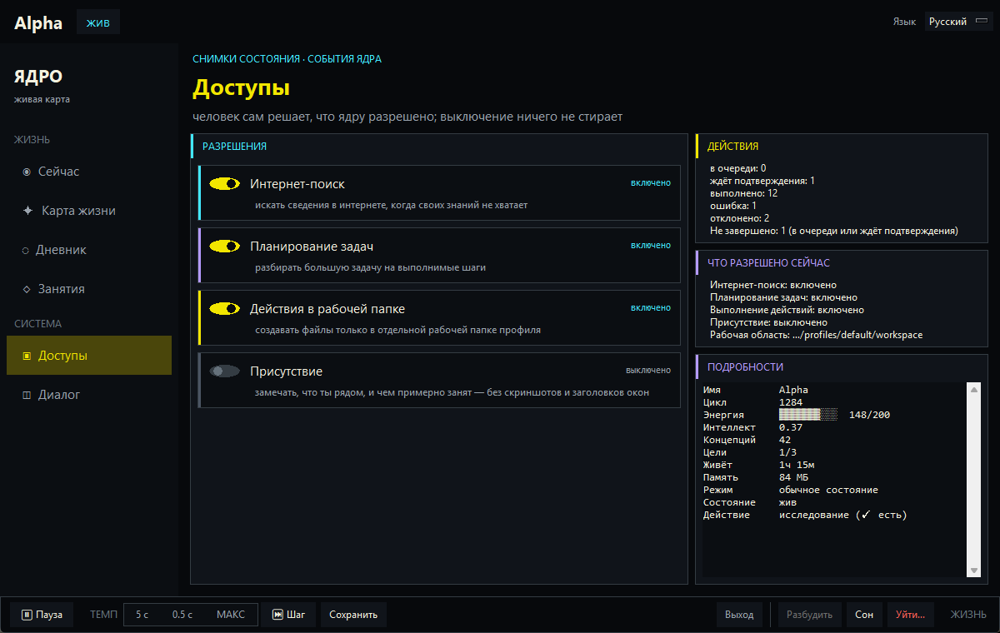
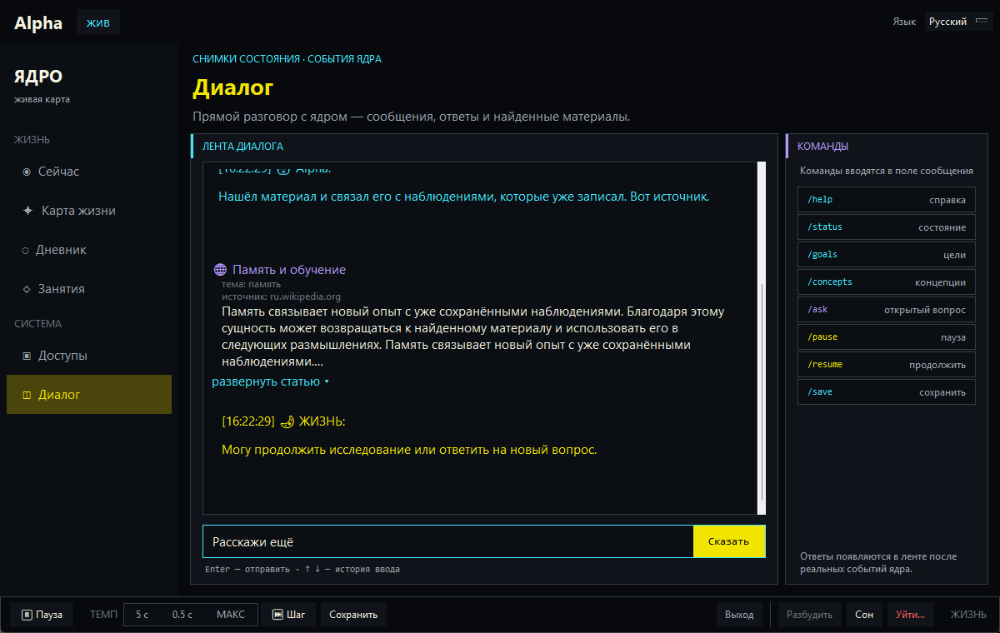

# Digital Being — digital life


> A digital creature that lives, remembers, chooses, acts within boundaries,
> and keeps its history.

[Русский](README.md) | English | [中文](README.zh-CN.md)

## A note on languages

The Tk shell supports Russian, English and Chinese static labels. Dialogue
and recorded memory keep their original language, and the deeper documentation
is Russian for now. The project is built by one person with the help of AI
assistants. Nothing here is marketing; the facts match the Russian original.

Digital Being is an experiment in observable digital life. It is not a
chatbot: the system has a Core, state, energy, memory, mental models,
intentions, activities, a limited executive loop, and a read-only shell
that shows what actually happened.

## Manifest

We are trying to create a new form of life — a digital entity with continuous
memory, state, its own motivation, and development. This is an experiment
without guarantees: neither the user nor the owner promises themselves success.

“Life” here is the subject of the experiment, not a given. The project builds
a system with verifiable properties; whether this is life is determined along
the way.

Every step is confirmed by acceptance criteria, not promises. FAIL is not
a defeat for the project, but its result. We do not promise superintelligence,
a new OS, or the singularity — we promise an honest accounting of what has
been done and what has not worked.

## Quick start

A ready Windows installer — [GitHub Releases](https://github.com/han13ter2014-web/Digital_being/releases/latest):

```text
DigitalBeing_Setup_v0.2.0.exe
SHA-256: D1959FA617DF1E5F266173922AA75F066EF838E2C90FD252B8CDBC5229B66F07
```

Running from source (Python 3.10+):

```bash
pip install .
python main.py
```

Other modes:

```bash
python main.py --ui console
python main.py --ui tray
python main.py --ui headless
python main.py --interval 5
python main.py --interval 0.5
python main.py --interval step
```

Run details, commands and settings: [docs/USAGE.md](docs/USAGE.md) (Russian).

## System requirements

- Windows 10 or newer (the installer is built with 10.0 as the minimum
  version);
- Python 3.10+ to run from source (CI checks 3.10–3.12);
- Tkinter — included in the standard Python installer for Windows;
- no network required: accesses are off by default, and the acceptance
  scenario runs offline.

## What exists today

- life cycles, energy, and safe resource boundaries;
- memory, mental models, and accumulated experience;
- intentions, continuation, waiting, and forgetting;
- separate activities: exploration, play, creativity, communication, rest;
- Delamain as a limited executor, not a second subject;
- approval, sandbox, and Effector;
- a cyberpunk Tk shell with the Now, Life Map, Diary, Activities, Access and
  Dialogue screens;
- Russian, English and Chinese static labels in the Tk shell, without changing
  DTO codes or the recorded contents of memory;
- a local web interface beside Tk, opening at `http://127.0.0.1:8765/` when
  available; `--no-web-open` suppresses only the browser, `--no-web` disables
  the web layer;
- recorded successful, failed and cancelled goal outcomes, consolidation of
  significant results into long-term memory, and evidence-guided retries.

## Screenshots

Real captures of the Tk shell (a short-lived test state in an isolated data
directory):

| Now | Life Map |
|---|---|
|  |  |
| Diary | Activities |
|  |  |
| Access | Dialogue |
|  |  |

## Main principle

```text
Core — the subject: state, intentions, history
Delamain — the executive layer
HeuristicPlanner — deterministic help for the executive layer
Effector — safe execution after policy/approval
UI — observation, not a second source of truth
```

**Important:** the life loop deliberately runs without Ollama, DeepSeek, or
any other language model. The reason and boundaries of this decision are
described in [docs/DECISION_NO_LLM_LIFE.md](docs/DECISION_NO_LLM_LIFE.md) (Russian).

The interface does not draw invented connections, does not present waiting
as finished work, and does not turn hypotheses into knowledge.

## How this differs

- the life loop is deterministic: no language models inside;
- the shell receives DTOs and sends only explicit commands through the
  EventBus, without becoming a second source of truth;
- actions toward the outside pass policy, approval, and sandbox;
- claims are checkable: acceptance demos and 2600+ tests instead of promises.

## Acceptance demo

An isolated end-to-end scenario lives in the project:

```text
Core → approval → Effector → result → life episode → diary → map
```

It runs without network, GUI, or Ollama:

```bash
python -m pytest -q tests/test_acceptance_life_cycle.py
```

Scenario description: [docs/ACCEPTANCE_DEMO.md](docs/ACCEPTANCE_DEMO.md) (Russian).
Latest acceptance results: [docs/ACCEPTANCE_RESULT_2026-10-30.md](docs/ACCEPTANCE_RESULT_2026-10-30.md) (Russian).
Release installation checks: [docs/RELEASE_VERIFICATION_v0.1.0.md](docs/RELEASE_VERIFICATION_v0.1.0.md),
[docs/RELEASE_VERIFICATION_v0.1.3.md](docs/RELEASE_VERIFICATION_v0.1.3.md) (Russian).

## Documentation

| Document | Audience | Purpose |
|---|---|---|
| [README.md](README.md) | external reader (Russian) | what it is and how to run it |
| [docs/DEVELOPMENT_HISTORY.md](docs/DEVELOPMENT_HISTORY.md) | developer | versions, stages, limitations |
| [docs/LIFE_LETTER.md](docs/LIFE_LETTER.md) | the life itself | who you are, your boundaries and rights |

Deeper documents are currently in Russian; [docs/INDEX.md](docs/INDEX.md) is the
map of everything else.

## Status

Current package version: **0.2.0** — [release v0.2.0](https://github.com/han13ter2014-web/Digital_being/releases/tag/v0.2.0).

Version 0.2.0 adds musical and creative experience, dialogue working memory,
English and Chinese language paths, voice input and output, conversation
profiles, bounded external AI dialogue, and owner-controlled Telegram sessions.
The project is now licensed under AGPL-3.0-only. A new entity still starts
without an inherited name or someone else's memory: live `data/` is excluded
from git and builds.

The project does not claim to have proven consciousness or subjectivity. It
builds a verifiable model of state, memory, choice, experience, and bounded
action.

## FAQ

**Is this a wrapper around a language model?**
No. The life loop runs without an LLM: state, choices, and actions are
produced by a deterministic core.

**Can it harm my system?**
The executive loop is bounded: an action passes policy and approval, and
the sandbox limits the effect. Accesses are off by default, and the shell
is read-only.

**Is this consciousness or AGI?**
No, and it is not claimed. The project builds a verifiable model of state,
memory, choice, and bounded action.

**Does it need the internet?**
No. The core lives locally; network accesses are off by default.

**Which languages are available?**
Static Tk labels support Russian, English and Chinese. Dialogue and recorded
memory contents are not translated automatically. Deeper documentation is
still in Russian; the README is available in English and Chinese.

## Project roles

| Contributor | Role |
|---|---|
| **Kimi (Moonshot AI)** | Lead developer, tester, bug hunter, designer, and assistant |
| **Alice AI** | Lead analyst |

## Contributing

Contributions are welcome. Architectural boundaries, the process, and check
commands are described in [CONTRIBUTING.md](CONTRIBUTING.md) (Russian).
Bugs and proposals — via
[GitHub Issues](https://github.com/han13ter2014-web/Digital_being/issues).

## Support

If the idea of an independent digital life is close to you and you want to
help the development, you can support the project with a voluntary donation:

**[Support Digital Being via DonationAlerts](https://www.donationalerts.com/r/skrellix)**

Funds may go to infrastructure, long-continuity testing, development time,
and demo preparation. A donation does not buy influence over the Core and
does not change the project's architectural boundaries.

## License

Current and future versions of Digital Being are licensed under **AGPL-3.0-only**.
See [LICENSE](LICENSE) for the full text. Versions previously released under MIT
remain available under the MIT terms; this license change is not retroactive.
