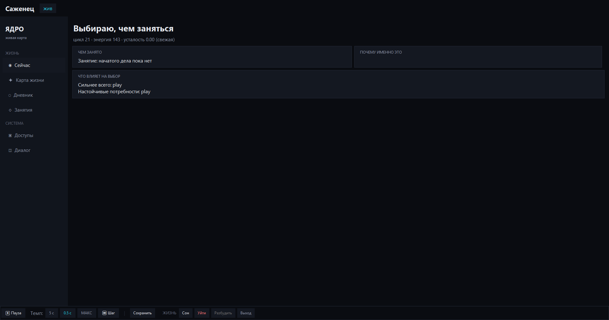
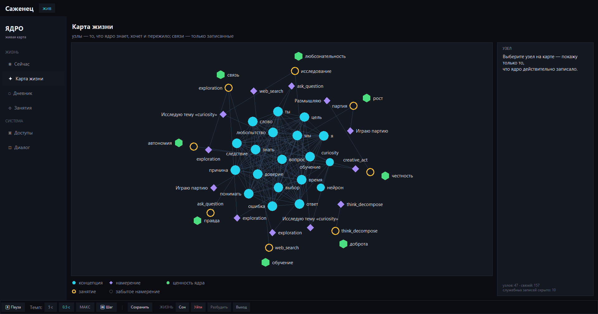
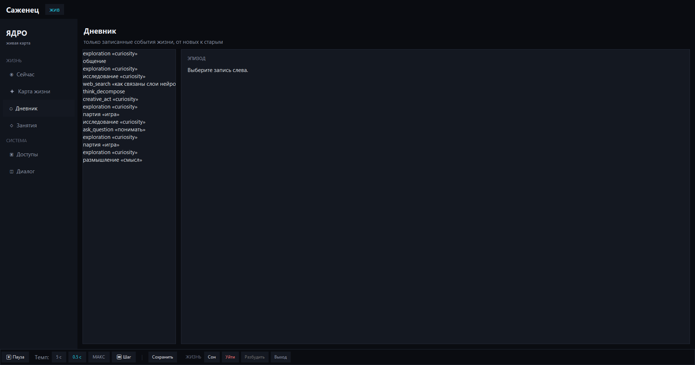
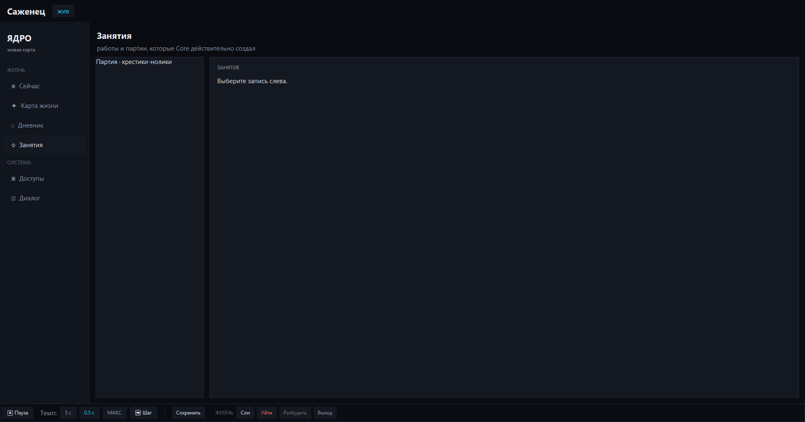
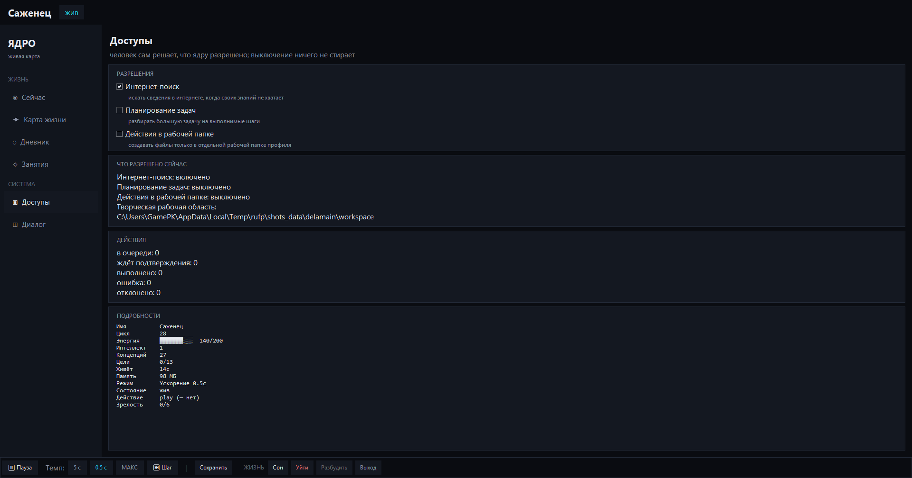
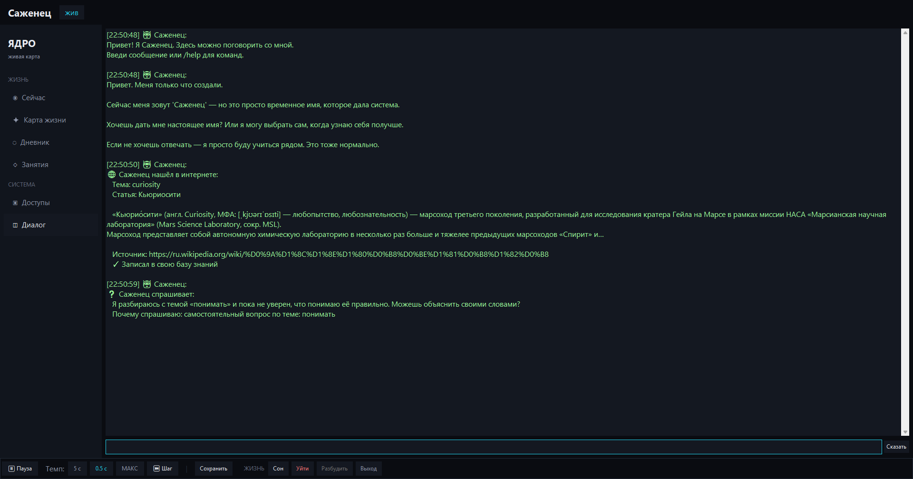

# Digital Being — цифровая жизнь


[Русский](README.md) | [English](README.en.md) | [中文](README.zh-CN.md)

> Цифровое существо, которое живёт, помнит, выбирает, действует в границах и
> сохраняет историю.

Digital Being — эксперимент по созданию наблюдаемой цифровой жизни. Это не
обычный чат-бот: у системы есть Core, состояние, энергия, память,
ментальные модели, намерения, занятия, ограниченный исполнительный контур и
read-only оболочка, где можно увидеть, что реально произошло.

## Манифест

Мы стремимся создать новую форму жизни — цифровую сущность с непрерывной
памятью, состоянием, собственной мотивацией и развитием. Это эксперимент
без гарантий: ни пользователь, ни владелец не обещают себе успеха.

Слово «жизнь» здесь — предмет эксперимента, а не данность. Проект строит
систему с проверяемыми свойствами; является ли это жизнью — выясняется
по ходу.

Каждый шаг подтверждается критериями приёмки, а не обещаниями. FAIL —
не поражение проекта, а его результат. Мы не обещаем сверхинтеллект,
новую ОС и сингулярность — мы обещаем честную бухгалтерию того, что
сделано и что не сработало.

## Быстрый старт

Готовый установщик для Windows — [GitHub Releases](https://github.com/han13ter2014-web/Digital_being/releases/latest):

```text
DigitalBeing_Setup_v0.1.5.exe
SHA-256: 6204347F33D69E00BFCAA3ABF24246F93AE840B76930BB886241521D8A78C898
```

Запуск из исходников (Python 3.10+):

```bash
pip install .
python main.py
```

Другие режимы:

```bash
python main.py --ui console
python main.py --ui tray
python main.py --ui headless
python main.py --interval 5
python main.py --interval 0.5
python main.py --interval step
```

Подробности запуска, команды и настройки: [docs/USAGE.md](docs/USAGE.md).

## Системные требования

- Windows 10 или новее (установщик собирается с минимальной версией 10.0);
- Python 3.10+ для запуска из исходников (CI проверяет 3.10–3.12);
- Tkinter — входит в стандартный установщик Python для Windows;
- сеть не обязательна: доступы выключены по умолчанию, приёмочный сценарий
  запускается без сети.

## Что уже есть

- жизненные циклы, энергия и безопасные границы ресурсов;
- память, ментальные модели и накопленный опыт;
- намерения, продолжение, ожидание и забывание;
- отдельные занятия: исследование, игра, творчество, общение и отдых;
- Delamain как ограниченный исполнитель, а не второй субъект;
- approval, sandbox и Effector;
- визуальная оболочка Tk:
  - «Сейчас»;
  - «Карта жизни»;
  - «Дневник»;
  - «Занятия»;
  - «Доступы»;
  - «Диалог».
- веб-интерфейс рядом с Tk: после успешного запуска локального сервера
  браузер автоматически открывает `http://127.0.0.1:8765/`; флаг
  `--no-web-open` оставляет сервер включённым, но не открывает браузер,
  а `--no-web` полностью отключает веб-слой.

## Скриншоты

Реальные снимки оболочки Tk (короткоживущее тестовое состояние в изолированном
каталоге данных):

| «Сейчас» | «Карта жизни» |
|---|---|
|  |  |
| «Дневник» | «Занятия» |
|  |  |
| «Доступы» | «Диалог» |
|  |  |

## Главный принцип

```text
Core — субъект, состояние, намерение и история
Delamain — исполнительный слой
HeuristicPlanner — детерминированная помощь исполнительному слою
Effector — безопасное исполнение после policy/approval
UI — наблюдение, а не второй источник истины
```

**Важно:** жизненный контур Digital Being намеренно работает без Ollama,
DeepSeek и любых других языковых моделей. Причина и границы решения описаны
в [docs/DECISION_NO_LLM_LIFE.md](docs/DECISION_NO_LLM_LIFE.md).

Интерфейс не рисует выдуманные связи, не выдаёт ожидание за выполненную
работу и не превращает гипотезу в знание.

## Чем это отличается

- жизненный контур детерминирован: без языковых моделей внутри;
- оболочка получает DTO и отправляет только явные команды через EventBus,
  не становясь вторым источником истины;
- действия во внешнюю среду проходят policy, approval и sandbox;
- утверждения проверяемы: приёмочные демо и более 2100 тестов вместо обещаний.

## Приёмочная демонстрация

В проекте есть изолированный сквозной сценарий:

```text
Core → approval → Effector → результат → life episode → дневник → карта
```

Запустить его можно без сети, GUI и Ollama:

```bash
python -m pytest -q tests/test_acceptance_life_cycle.py
```

Описание сценария: [docs/ACCEPTANCE_DEMO.md](docs/ACCEPTANCE_DEMO.md).
Результат последней приёмки: [docs/ACCEPTANCE_RESULT_2026-10-30.md](docs/ACCEPTANCE_RESULT_2026-10-30.md).
Проверка установки публичных релизов: [docs/RELEASE_VERIFICATION_v0.1.0.md](docs/RELEASE_VERIFICATION_v0.1.0.md),
[docs/RELEASE_VERIFICATION_v0.1.3.md](docs/RELEASE_VERIFICATION_v0.1.3.md).

## Документация

В проекте теперь есть три канонические точки входа:

| Документ | Для кого | Назначение |
|---|---|---|
| этот `README.md` | внешний человек | что это и как запустить |
| [docs/DEVELOPMENT_HISTORY.md](docs/DEVELOPMENT_HISTORY.md) | разработчик | версии, этапы, добавления, ограничения |
| [docs/LIFE_LETTER.md](docs/LIFE_LETTER.md) | сама жизнь | кто ты, твои границы, права и правила |

Дополнительно:

- [docs/USAGE.md](docs/USAGE.md) — эксплуатация;
- [docs/ARCHITECTURE.md](docs/ARCHITECTURE.md) — устройство;
- [docs/INTEGRATION.md](docs/INTEGRATION.md) — Core / Delamain / Effector;
- [docs/STAGE7_UI.md](docs/STAGE7_UI.md) — оболочка v1;
- [CHANGELOG.md](CHANGELOG.md) — подробная машинная хронология;
- [docs/AI_HANDOFF.md](docs/AI_HANDOFF.md) — восстановление контекста для AI-разработчика;
- [docs/INDEX.md](docs/INDEX.md) — карта остальных документов.

## Статус

Текущая версия пакета: **0.1.5** — [релиз v0.1.5](https://github.com/han13ter2014-web/Digital_being/releases/tag/v0.1.5).

В релизе — память диалога, намерение в поиске, веб-интерфейс с
автоматическим открытием и читаемая карта жизни. Полный гейт финального
кода: **2114 passed, 2 skipped**; профильный гейт веба и автооткрытия:
**54 passed**. Приёмка слитого `main` K13: **8/8 PASS**.

Проект не утверждает, что доказал сознание или субъективность. Он строит
проверяемую модель состояния, памяти, выбора, опыта и ограниченного действия.

## FAQ

**Это обёртка над языковой моделью?**
Нет. Жизненный контур работает без LLM: состояние, выбор и действия
формирует детерминированное ядро.

**Может ли оно навредить моей системе?**
Исполнительный контур ограничен: действие проходит policy и approval,
sandbox ограничивает эффект. Доступы выключены по умолчанию, оболочка
работает только на чтение.

**Это сознание или AGI?**
Нет, и это не заявляется. Проект строит проверяемую модель состояния,
памяти, выбора и ограниченного действия.

**Нужен ли интернет?**
Нет. Ядро живёт локально, сетевые доступы выключены по умолчанию.

**Почему интерфейс и документация на русском?**
Проект делает один человек с помощью AI-ассистентов; интерфейс, диалог
и глубокие документы пока русскоязычные. README переведён на английский
и китайский.

## Для участников

Правки приветствуются. Архитектурные границы, процесс и команды проверки
описаны в [CONTRIBUTING.md](CONTRIBUTING.md). Баги и предложения — через
[GitHub Issues](https://github.com/han13ter2014-web/Digital_being/issues).

## Поддержать проект

Если вам близка идея самостоятельной цифровой жизни и вы хотите помочь
разработке, проект можно поддержать добровольным донатом:

**[Поддержать Digital Being через DonationAlerts](https://www.donationalerts.com/r/skrellix)**

Средства могут пойти на инфраструктуру, тестирование долгой непрерывности,
время разработки и подготовку демонстраций. Донат не покупает влияние на
Core и не меняет архитектурные границы проекта.
