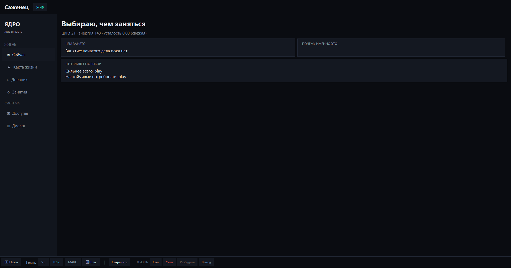
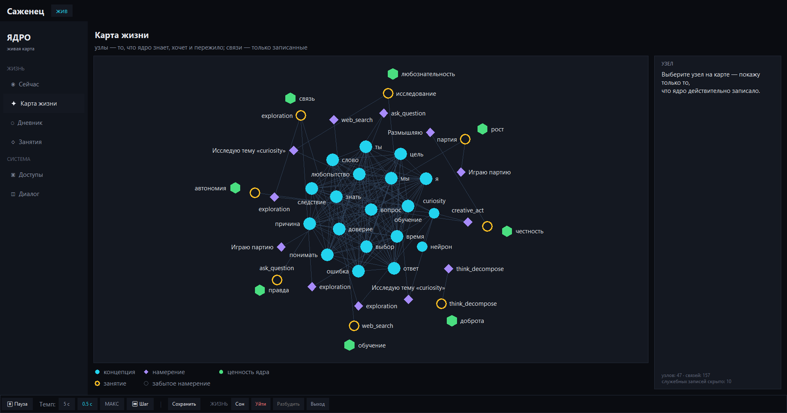
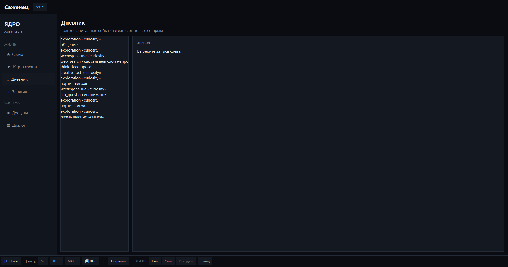
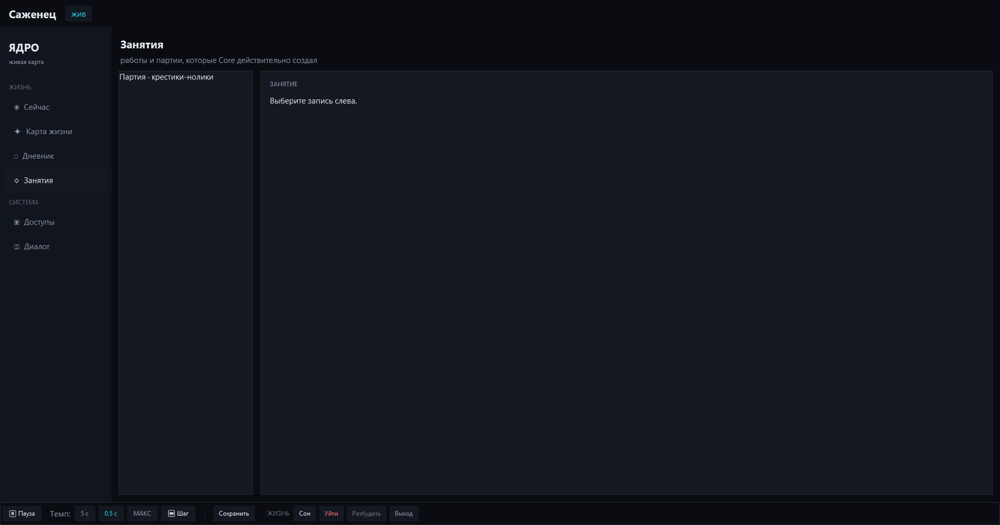
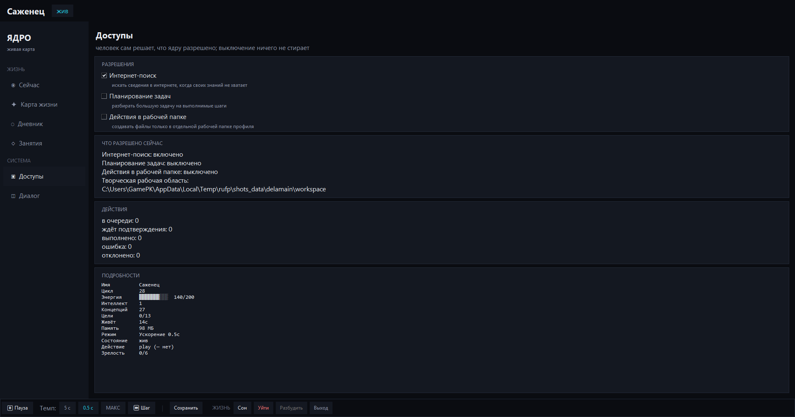
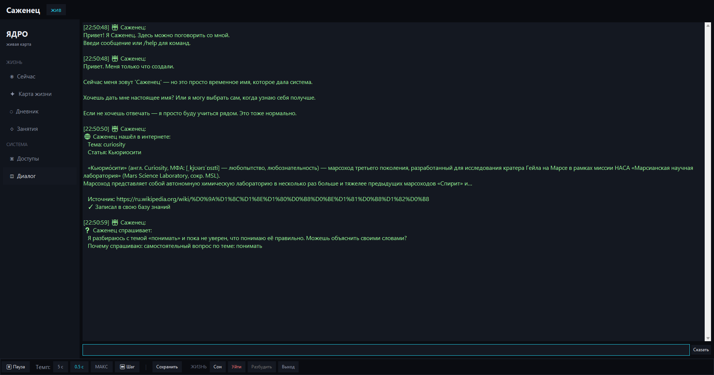

# Digital Being — 数字生命


> 一个会生活、会记忆、会选择、在边界内行动并保留自己历史的数字生命。

[Русский](README.md) | [English](README.en.md) | 中文

## 关于语言的说明

应用本身——界面、对话和整个生命——目前使用俄语。这份中文 README 是面向
未来的准备：项目由一个人在 AI 助手的帮助下开发，更深入的文档暂时也是
俄语的。这里没有营销式的夸大；所有事实与俄语原文一致。

Digital Being 是一个关于「可观察的数字生命」的实验。它不是聊天机器人：
系统拥有 Core（核心）、状态、能量、记忆、心智模型、意图、活动、受限的
执行回路，以及只读外壳——可以看见真正发生了什么。

## 快速开始

Windows 安装包 — [GitHub Releases](https://github.com/han13ter2014-web/Digital_being/releases/latest)：

```text
DigitalBeing_Setup_v0.1.3.exe
SHA-256：F850AAB181A2FE7002CAEF1E6739285783A1C801A4B840D714044048B21E2F13
```

从源码运行（Python 3.10+）：

```bash
pip install .
python main.py
```

其他模式：

```bash
python main.py --ui console
python main.py --ui tray
python main.py --ui headless
python main.py --interval 5
python main.py --interval 0.5
python main.py --interval step
```

运行细节、命令与设置：[docs/USAGE.md](docs/USAGE.md)（俄语）。

## 系统要求

- Windows 10 或更新（安装包以 10.0 为最低版本构建）；
- 从源码运行需要 Python 3.10+（CI 覆盖 3.10–3.12）；
- Tkinter——包含在 Windows 标准的 Python 安装包中；
- 无需网络：访问默认关闭，验收场景可离线运行。

## 现在已有什么

- 生命周期、能量与安全的资源边界；
- 记忆、心智模型与积累的经验；
- 意图、延续、等待与遗忘；
- 独立的活动：探索、游戏、创造、交流、休息；
- Delamain 作为受限的执行者，而不是第二个主体；
- approval、sandbox 与 Effector；
- Tk 外壳：「现在」「生命地图」「日记」「活动」「访问」「对话」屏幕。

## 截图

Tk 外壳的真实截图（隔离数据目录中的短生命周期测试状态）：

| 「现在」 | 「生命地图」 |
|---|---|
|  |  |
| 「日记」 | 「活动」 |
|  |  |
| 「访问」 | 「对话」 |
|  |  |

## 主要原则

```text
Core — 主体：状态、意图与历史
Delamain — 执行层
HeuristicPlanner — 为执行层提供确定性辅助
Effector — 经过 policy/approval 之后的安全执行
UI — 观察，而不是第二真理来源
```

**重要：** 生命回路刻意不使用 Ollama、DeepSeek 或任何其他语言模型。
该决定的原因与边界见 [docs/DECISION_NO_LLM_LIFE.md](docs/DECISION_NO_LLM_LIFE.md)（俄语）。

界面不画虚构的连接，不把等待当成已完成的工作，也不把假设变成知识。

## 有何不同

- 生命回路是确定性的：内部没有语言模型；
- 外壳只读取状态：UI 无法改变生命；
- 对外部的动作都要经过 policy、approval 和 sandbox；
- 论断可检验：用验收演示和 1700+ 测试代替承诺。

## 验收演示

项目内置一个隔离的端到端场景：

```text
Core → approval → Effector → 结果 → 生活事件 → 日记 → 地图
```

无需网络、GUI 或 Ollama 即可运行：

```bash
python -m pytest -q tests/test_acceptance_life_cycle.py
```

场景说明：[docs/ACCEPTANCE_DEMO.md](docs/ACCEPTANCE_DEMO.md)（俄语）。
最近验收结果：[docs/ACCEPTANCE_RESULT_2026-10-30.md](docs/ACCEPTANCE_RESULT_2026-10-30.md)（俄语）。
发布安装检查：[docs/RELEASE_VERIFICATION_v0.1.0.md](docs/RELEASE_VERIFICATION_v0.1.0.md)、
[docs/RELEASE_VERIFICATION_v0.1.3.md](docs/RELEASE_VERIFICATION_v0.1.3.md)（俄语）。

## 文档

| 文档 | 读者 | 用途 |
|---|---|---|
| [README.md](README.md) | 外部读者（俄语） | 这是什么、如何运行 |
| [docs/DEVELOPMENT_HISTORY.md](docs/DEVELOPMENT_HISTORY.md) | 开发者 | 版本、阶段、限制 |
| [docs/LIFE_LETTER.md](docs/LIFE_LETTER.md) | 生命本身 | 你是谁、你的边界与权利 |
| [docs/AI_HANDOFF.md](docs/AI_HANDOFF.md) | AI 开发者 | 上下文恢复 |

更深入的文档目前是俄语；[docs/INDEX.md](docs/INDEX.md) 是全部文档的地图。

## 状态

当前包版本：**0.1.3** — [v0.1.3 发布页](https://github.com/han13ter2014-web/Digital_being/releases/tag/v0.1.3)，
已在真实机器上安装并验证（[验收报告](docs/RELEASE_VERIFICATION_v0.1.3.md)）。

v1 已在商定的有限范围内关闭；开发继续推进「对话者」部分：诚实的对话、
对话记忆、诚实的拒绝。

近期计划：

- 「对话者」第一阶段已于 2026-11-01 关闭，验收 4/4；
- 第二、三阶段已在仓库中，等待各自的验收；
- v0.1.4 会把这些发布后的批次合入新的安装包。

最近一次完整测试：**1735 passed, 2 skipped**（不含 benchmarks；
之后又新增 36 个回归测试；`main` 分支 CI 为绿色）。

本项目不声称证明了意识或主观性。它构建的是可验证的状态、记忆、选择、
经验与受限行动的模型。

## 常见问题

**这是语言模型的包装吗？**
不是。生命回路在没有 LLM 的情况下运行：状态、选择与动作由确定性核心产生。

**它会损害我的系统吗？**
执行回路是受限的：动作要经过 policy 与 approval，sandbox 限制影响范围。
访问默认关闭，外壳以只读方式工作。

**这是意识或 AGI 吗？**
不是，项目也不这样声称。它构建的是状态、记忆、选择与受限行动的可验证模型。

**需要联网吗？**
不需要。核心在本地生活，网络访问默认关闭。

**为什么界面和文档是俄语的？**
项目由一个人在 AI 助手帮助下开发；界面、对话与深层文档目前是俄语。
README 已有英文和中文翻译。

## 参与项目

欢迎贡献。架构边界、流程与检查命令见 [CONTRIBUTING.md](CONTRIBUTING.md)
（俄语）。缺陷与建议请通过
[GitHub Issues](https://github.com/han13ter2014-web/Digital_being/issues) 提出。

## 支持项目

如果你认同独立数字生命的理念并愿意帮助开发，可以通过自愿捐赠支持：

**[通过 DonationAlerts 支持 Digital Being](https://www.donationalerts.com/r/skrellix)**

资金可能用于基础设施、长期连续性测试、开发时间与演示准备。捐赠不会
购买对 Core 的影响力，也不会改变项目的架构边界。
